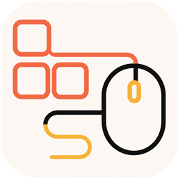
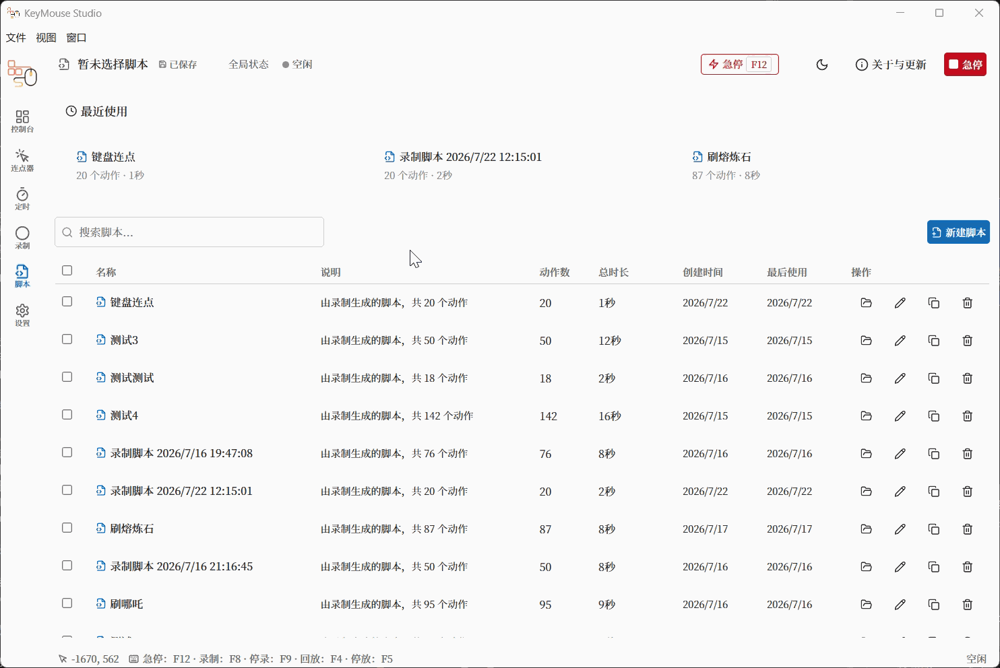
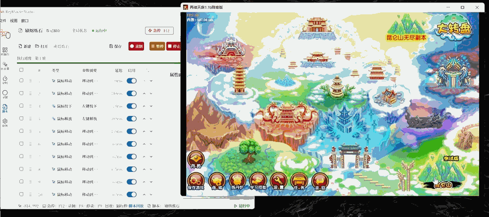

  

<h1 align="center">KeyMouse Studio</h1>

  面向 Windows 的本地键鼠自动化工具 
  连点 · 定时点击 · 录制 · 脚本编辑与回放

  <a href="./README.en.md">English</a>

  
  
  
  
  

## 下载安装

1. 打开 [最新版本 Release](https://github.com/Geo-ff/keymouse-studio/releases/latest)
2. 下载 **`KeyMouse-Studio-Setup-*.exe`**
3. 双击安装并启动 **KeyMouse Studio**

若 GitHub 访问较慢，可使用 [国内备用下载（夸克网盘）](./docs/domestic-download.md)。

**系统要求**：Windows 10 / 11（x64）

**说明**：

- 安装包内已包含运行所需组件，**无需**自行安装 Python
- 当前安装包可能**未做代码签名**，Windows SmartScreen 可能提示未知应用：选择「更多信息」→「仍要运行」
- 建议优先从本仓库的 GitHub Releases 下载；国内网络不便时再使用夸克网盘备用源
- **请认准官方来源**：GitHub 用户 `Geo-ff` / 仓库 `keymouse-studio`

## 快速上手

1. 安装并打开应用
2. 在侧边栏选择 **连点器 / 定时 / 录制 / 脚本** 等功能
3. 配置参数后启动；需要时可使用 **急停**（默认快捷键 **F12**）
4. 常用操作可设快捷键，在任何窗口直接触发：**设置 → 全局快捷键** 中设置连点器开关键，**脚本** 页面的列表中为单个脚本设置快捷键（按一下运行，再按一下停止；用快捷键启动时不倒计时）
5. 菜单 **文件 → 关于与检查更新**，或工具栏 **关于与更新**，可查看版本、检查更新与打开官方仓库

## 功能概览

| 功能 | 能做什么 |
| --- | --- |
| 连点器 | 按设定间隔自动点击或按键（次数或持续、坐标或当前位置）；可设开关快捷键，在游戏里按一下开始、再按一下停止 |
| 定时点击 | 延迟一段时间后执行点击 |
| 录制 | 记录键鼠操作，生成可编辑脚本 |
| 脚本编辑 | 增删改动作、排序、启用/禁用 |
| 脚本回放 | 按速度与循环次数回放，支持暂停/继续/停止 |
| 脚本管理 | 保存、加载、复制、删除本地脚本；列表中一键运行，并可为常用脚本单独设置快捷键 |
| 安全控制 | 全局急停，尽量释放已按下的键鼠状态 |
| 自动更新 | 启动后检查新版本；也可在「关于」中手动检查 |

**当前版本不包含**：云同步、账号、在线脚本市场、macOS / Linux、图像识别 / OCR 等。

## 演示视频

### 展示视频

  

### 实机演示

  

## 自动更新

- 使用官方安装包时，启动后会在后台检查 [GitHub Releases](https://github.com/Geo-ff/keymouse-studio/releases) 是否有新版本
- 发现更新时可下载；下载过程中界面会显示进度
- 下载完成后可选择立即重启安装，或稍后安装
- 也可在 **关于** 弹窗中手动「检查更新」

## 使用注意

- 本工具在**本机**模拟键鼠输入，请仅在你有权操作的环境中使用
- 请遵守操作系统、游戏、网站或软件的服务条款与当地法律法规；因滥用造成的后果由使用者自行承担
- 脚本数据保存在本地，应用**不会**把你的脚本上传到云端
- 急停快捷键可在设置中调整；执行重要操作前建议先确认急停可用

## 在游戏中不生效？

- **以管理员身份运行**：很多游戏（或它的启动器）以管理员权限运行，Windows 会拦截普通权限程序发出的键鼠输入。此时任务会自动暂停并提示；请右键 KeyMouse Studio →「以管理员身份运行」后重试
- **按键与点击**：按键以硬件扫描码发送，鼠标点击会按住一小段时间（约 30 ms），以便读取 DirectInput / Raw Input 或逐帧检测输入的游戏能够识别。旧版本录制的脚本无需重新录制
- **3D 视角转动**：第一/第三人称游戏用鼠标的相对位移控制视角，光标坐标对它无效。录制前在录制页把「鼠标移动录制方式」切换为「游戏视角（相对移动）」；也可以在脚本编辑器中手动添加「视角移动」动作，设置位移和时长。录制时记录的是鼠标原始位移，回放效果还受游戏内灵敏度影响，录制和回放时请保持相同的灵敏度设置
- **带反作弊的游戏**：部分游戏会主动忽略软件模拟的输入，本工具不提供任何绕过手段；在这类游戏中使用自动化也可能违反其用户协议，请自行确认

## 支持项目

本项目坚持免费开源，由个人利用业余时间持续开发和维护。制作不易，点个 [Star](https://github.com/Geo-ff/keymouse-studio) 就是对我努力最大的支持。

## 社区认可

感谢 [LINUX DO](https://linux.do) 社区为开源项目提供友好、开放的交流环境，也感谢社区成员对 KeyMouse Studio 的关注与支持。

## 反馈

遇到问题或有建议，欢迎通过以下方式反馈：

- 提交 [GitHub Issue](https://github.com/Geo-ff/keymouse-studio/issues)
- 使用微信扫描下方二维码，加入 **KeyMouse Studio 使用反馈群**

  

> 微信群二维码将在 **2026 年 8 月 11 日前**有效；若二维码失效，请通过 GitHub Issue 联系维护者更新。

## 开发者

若你要改代码、跑测试或自己打包安装包，请阅读：

- [开发与构建说明](./docs/development.md)
- [项目跟踪](./docs/project-tracker.md)
- [后端设计](./docs/backend-design.md)

技术栈概览：Electron · React · TypeScript · Python（FastAPI）

## 许可证

本项目采用 [MIT License](./LICENSE) 开源。
